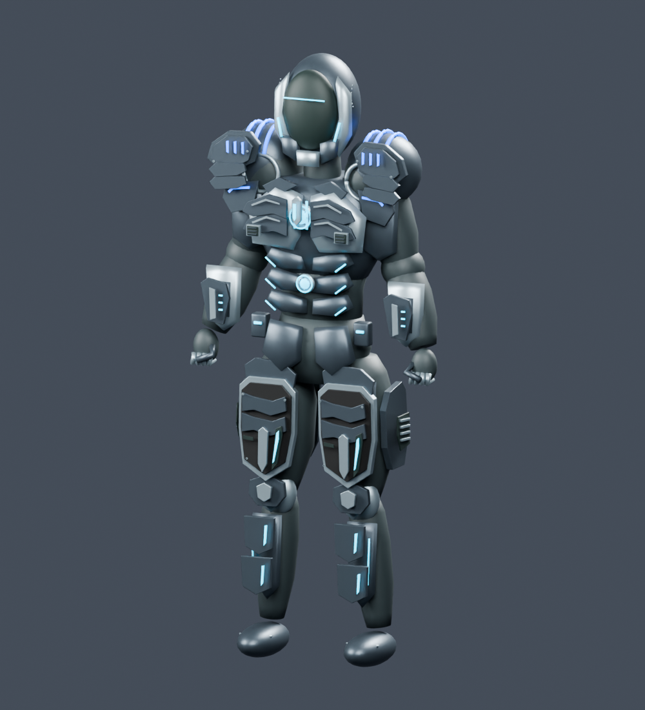

# Traveler — reinforced Chrono armor

The 29 October 2026 revision strengthens the actual runtime resource at `Assets/Alterverse/Resources/ChronoTraveler/Model.bytes`. The old authored FBX remains the animation/fitting rig; the appearance component loads this replacement geometry.



## Design

- The middle of each thigh is approximately 35% wider and 37% deeper, tapered back into the original hip and knee centers. New broad carbon cuisses have titanium frames, overlapping graphite lames, raised center keels, recessed cyan channels, shear bolts and wraparound side/rear armor.
- Faceted shoulder crowns and lower scales cover the former simple domes. Blue status strips retain the Traveler's shoulder identity. Layered thoracic scutes, inset extractor pockets, a sternal chrono key, diagnostic vambraces, stepped greaves and rear reactor cages give the armor physical depth.
- All 124 new parts are closed native meshes and remain separately editable in [TravelerReinforced.blend](TravelerReinforced.blend). Carbon UV density matches the existing compact runtime twill.
- The generic `HeroLimbTechDetails` overlay is skipped when the authored Chrono appearance is present, avoiding extra service plates over the new armor. Existing boot presentation remains active.

## Verified runtime resource

| Item | Result |
| --- | --- |
| Triangles | 35,992; previously 28,204 |
| Runtime vertices | 38,617; within 16-bit index capacity |
| Existing material slots | 7 |
| Existing fitting anchors | 16, unchanged |
| Closed added armor parts | 124 |
| Resized original thigh vertices | 584 |
| Original non-thigh vertices/normals | Exact comparison passed |
| Original non-carbon triangle indices | Exact comparison passed |

The former two narrow carbon badges (80 triangles) are replaced by structural shells. Bone names, anchors, resource path, resource GUID, schema version, original imported FBX, animation clips, orb, hands, helmet and combat settings remain intact. No phone fallback is enabled. See [reinforced-armor-validation.json](reinforced-armor-validation.json).

The reproducible builder is [../../../Tools/ChronoTraveler/reinforce_armor.py](../../../Tools/ChronoTraveler/reinforce_armor.py). It accepts the pinned pre-change runtime payload and stops on unknown input or an already reinforced payload; this prevents stacking duplicate plates. To regenerate only previews from the saved native source:

```bash
blender --background --threads 4 --python-exit-code 1 --python Tools/ChronoTraveler/reinforce_armor.py -- --render-only
```

[Front](reinforced-front.png), [angle](reinforced-angle.png) and [rear](reinforced-back.png) show the actual resource geometry in Blender's studio. They exclude Unity's later fitting/boot presentation and the separately retained orb. Unity compilation, native client rendering, Android builds and listening checks have not been run here.
