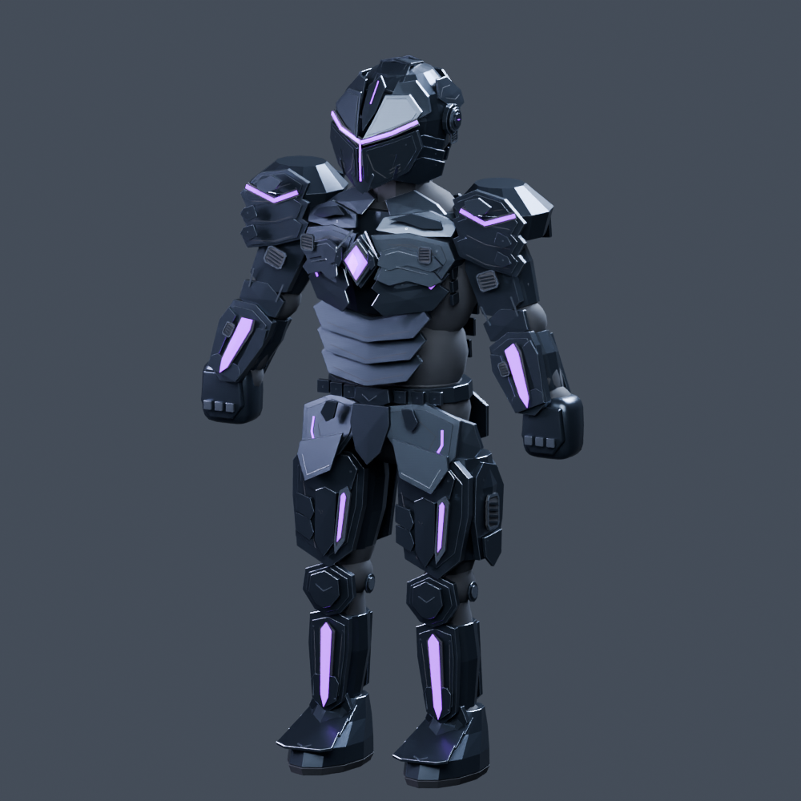

# Void Knight – Armor V3 implementation

The 29 October 2026 V3 armor/helmet concepts are implemented as editable Blender geometry on the existing animated hero. The reinforced version is geometry revision 8: broader thighs and deeper, articulated hard-surface armor. The concept's **V3** name is retained separately from source revision numbers.



## Changes

- Rebuilt closed helmet with a narrow V visor and central illuminated slit, overlapping crown/cheek/nape plates, temple service caps, seated hardware and surface markings.
- Layered chest plates and core bezel, segmented shoulders, abdominal lames, split hip guards, thigh shells, knee pivots, shin inserts and instep plates.
- Secondary panel islands provide real inset borders. Main plates and luminous inserts remain separate editable objects. Small hardware and markings are batched by assembly, material and bone.
- Reinforced cuisses measure 235 mm across versus 177 mm previously (+33%); depth is 282 mm versus 195 mm (+45%). Broad quadriceps shells taper into the original knees, with layered lames, outer cooling cassettes, rear closures and recessed violet channels.
- Added swept chest scutes, core locks, clavicle bridges, flank ribs, scapular extractors, shoulder relief, split forearm casings and raised knee shields. Vent pockets contain modeled slats and closed flanges.
- Existing five material definitions and packed surface images are retained. Runtime shaders and gameplay code are unchanged.
- Original sword, hands, undersuit and 19-bone rest skeleton are preserved. Revision 8 preserves every action key/handle from the previously corrected carry. The blade clears arms, head and chest in all Idle/Run frames. All 12 clip identities, frame ranges, FBX path and asset GUID remain unchanged.

The production source is [../VoidKnight.blend](../VoidKnight.blend). Individual rest-aligned assemblies are in [../Modules](../Modules). The runtime file remains `Assets/Alterverse/Resources/AuthoredHeroes/VoidKnight.fbx`.

## Verified artifact

| Item | Result |
| --- | --- |
| Editable source mesh objects | 455 |
| Newly built armor/detail objects | 306 |
| Protected original mesh objects compared | 149 |
| Runtime mesh objects | 2: `DF_Anatomy`, `DF_WeaponR` |
| Runtime triangles | 34,330; previous V3 model 28,722; below the 35,000 budget |
| Materials | 5 |
| Original skeleton | 19 bones |
| Animation clips | 12; 384 evaluated frames |
| Individual assembly files opened | 17 |
| Sword-to-eye visibility checks | 180 rays |

The independent [source validation](source-validation.json) compares protected vertex coordinates, topology, material slots, UVs, weights, bone rest matrices and **all** action keys/handles to the previously shipped V3 source. [Build validation](build-validation.json) lists every new module and binding. [Carry validation](carry-clearance-validation.json) checks blade/armor intersections without rebaking animation. Existing refinement, module and FBX checks also pass: 384 evaluated frames, 180 eye visibility rays and all 17 editable assemblies.

## Rebuild and inspect

Use Blender 5.0.1, from the repository root. The builder is repeatable: it replaces the armor while retaining protected meshes and actions from the input production source.

```bash
blender --background --threads 4 --python-exit-code 1 --python ArtSource/Heroes/VoidKnight/Armor-V3/build_armor_v3.py
blender --background --threads 4 --python-exit-code 1 --python ArtSource/Heroes/VoidKnight/Armor-V3/fix_carry_clearance.py -- --verify-only
blender --background --threads 4 --python-exit-code 1 --python ArtSource/Heroes/VoidKnight/Armor-V3/validate_armor_v3.py
blender --background --threads 4 --python-exit-code 1 --python ArtSource/Heroes/VoidKnight/export_void_knight.py
blender --background --threads 4 --python-exit-code 1 --python ArtSource/Heroes/VoidKnight/validate_fbx.py
blender --background --threads 4 --python-exit-code 1 --python ArtSource/Heroes/VoidKnight/export_modules.py
blender --background --threads 4 --python-exit-code 1 --python ArtSource/Heroes/VoidKnight/validate_modules.py
blender --background --threads 4 --python-exit-code 1 --python ArtSource/Heroes/VoidKnight/validate_refinement.py
blender --background --threads 4 --python-exit-code 1 --python ArtSource/Heroes/VoidKnight/Armor-V3/render_armor_v3.py
```

To compare against an independently retained, previously corrected V3 file, add `-- --before /absolute/path/to/baseline.blend` to `validate_armor_v3.py`. Use `--allow-carry-fix` only for comparison with an older, uncorrected carry. `fix_carry_clearance.py -- --verify-only` checks the existing pose without resampling its keys; omitting that flag intentionally rebakes the original carry correction.

## References and presentation

- [Armor concept](Concept-Armor.png), [helmet concept](Concept-Helmet.png), [German Blender plan](Blender-Bauplan.md).
- [Helmet close-up](Renders/helmet-angle.png), [front](Renders/armor-front.png), [rear](Renders/armor-back.png).
- Actual action-pose studio renders: [carry](Renders/carry.png), [attack contact](Renders/attack.png), [guard](Renders/guard.png), [ultimate contact](Renders/ultimate.png).

The illustrated concepts are adapted to the existing proportions, skeleton and real-time mesh budget. The studio images show the actual Blender geometry. Native Unity import/rendering and an Android device build have not been run in this environment; those remain the final presentation check in the client project.
