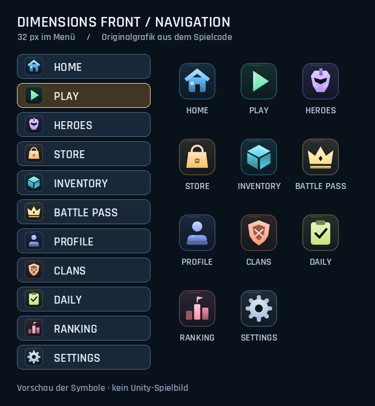

# Coloured menu navigation

The home menu and command-deck navigation use the same cached, two-tone artwork.
Each section retains its own colour when selected; the existing button frame still
indicates selection. Filled silhouettes and a small dark backing improve reading
against the orbital background. Clans has a shield instead of the Home fallback.

| Section | Shape | Colour |
| --- | --- | --- |
| Home | House | Sky blue |
| Play | Launch triangle | Emerald |
| Heroes | Helmet | Violet |
| Store | Shopping bag | Amber |
| Inventory | Supply crate | Cyan |
| Profile | Portrait | Periwinkle |
| Daily | Checklist | Lime |
| Ranking | Podium | Rose |
| Settings | Gear | Silver blue |
| Battle Pass | Crown | Gold |
| Clans | Shield | Coral |

The existing `FrontEndNavigation` helper builds each 96px texture once and reuses
it. It uses no font symbols, downloaded resources or additional packages. Icons
are centred in the existing button rectangles. The home-page Ranking, Settings
and Clans shortcuts use the same navigation helper; their destinations are retained.

## Verification

The complete production `FrontEndNavigation` and `FrontEndTheme` classes compiled
with C# 9 against controlled engine substitutes. The preview above uses their
exported pixel data, with the bundled Rajdhani font for labels. It is an artwork
preview, not a Unity screenshot.

Checks confirmed distinct coloured artwork for all 11 sections, texture reuse,
restoration of the GUI colour, and 16 combinations of button height and selected /
primary state. Icon centring, space before the label, the authored click rectangle
and one existing confirmation sound per click were retained.

Native Unity / Android rendering and the final on-device background contrast
still need a visual check after pulling and rebuilding the client.
