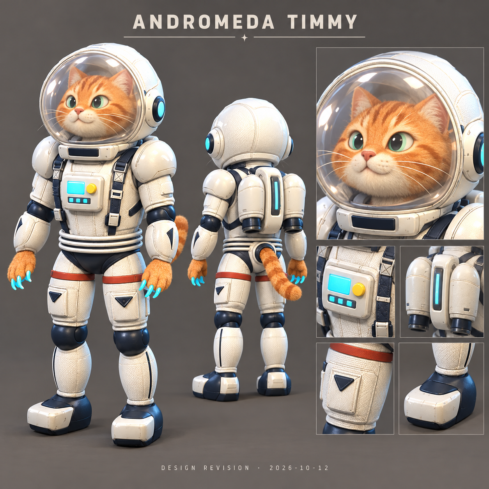

# Andromeda Timmy — Herkunft und Entwurf

Interne ID: `Timmy`. Nachweissammlung erstellt am 2026-10-12.

## Zeitliche Einordnung

Die Chronik wird aus vorhandenen Repository-Commits rekonstruiert. Ein Commitdatum ist kein Beweis für den Zeitpunkt einer früheren Idee. Neue Konzeptblätter werden nicht rückdatiert.

| Commitdatum (UTC) | Entwicklungsschritt | GitHub-Beleg |
|---|---|---|
| 2026-10-11T12:34:39Z | Add Andromeda Timmy Season 2 preview, astronaut cat art and contact-based Scratch

Integrate a small fast melee assassin with Claw Swipe, Stardust, Jet Pounce and a fixed-end single-hero leap into a two-second interruptible Scratch channel. Reuse aiming, collision, cooldown, pose, VFX and NGO pipelines; preserve the live eight-hero roster behind a Season 2 editor preview gate.

Include editable Blender model/icon sources, FBX, five HUD icons, central draft balance values and implementation/playtest notes. Validation: 2,115 deterministic combat/input assertions, 294,488 existing pose assertions, Blender source/FBX rig/weight/socket checks and C# syntax checks. Native Unity/device/multiplayer playtests remain required before release. | [42d08bd1](https://github.com/Lowperformence/Alterverse/commit/42d08bd1773a74a920e4ec2f6977ed18e89a6d79) |
| 2026-10-11T13:22:09Z | Add Timmy's transparent round visor and selected Q/W/ultimate sounds

Preserve the existing rig and legacy sound cues. Play each selected recording once, including multi-target Stardust and the four Scratch ticks. Validate source/FBX glass geometry and 2,268 combat/input/audio assertions. | [625de160](https://github.com/Lowperformence/Alterverse/commit/625de16097fa24bf1d54318e1d65b5999fcc51b5) |
| 2026-10-11T14:18:58Z | Polish Timmy's astronaut model, icons and synchronized skill VFX

Stardust now throws a visible grenade to the selected point during its existing 0.3s warning. At impact it uses a 2m radius, slows for 2s and keeps cosmetic mist visible for 2s without extra damage ticks. Claw Swipe deals 40 damage. Jet Pounce follows both backpack nozzles, and Scratch launches three claws ahead of its fixed leap.

Add a round 80%-transparent visor, woven suit detail, baked tabby fur/fabric textures, five illustrated HUD icons with backgrounds and a centered tail with an eight-second sway. Reuse the existing rig/pool and preserve other heroes' stats and asset GUIDs; append a dedicated timestamped Timmy presentation cue.

Validation: 2530 deterministic gameplay/input/audio/VFX assertions; Blender source and FBX round-trip checks; production C# syntax checks. Native Unity/device rendering and real two-peer transport remain to be tested. | [32ba793b](https://github.com/Lowperformence/Alterverse/commit/32ba793b16043f4ccb62ad72518d3bcd6502c406) |
| 2026-10-11T15:09:35Z | Refine Timmy’s feline model and fix attack contact and Scratch movement

Give Timmy tapered cat paws with four toes and feline face proportions, preserving the existing rig, renderer setup and Unity GUIDs. Rebuild and validate the Blender source, FBX and textures within the 18k triangle budget.

Track the selected melee basic target at release. Connect Scratch during its fixed leap or at point-blank range, root only the victim for two seconds, and keep Timmy free to move and use attacks after contact. If the target is missing or leaves acquisition range before takeoff, still commit the directional leap without damage or root. Preserve queued basics and hold ticks during ordinary movement, while retaining real interruption and source-owned cleanup.

Set Jet Pounce to 4.5 m and explicitly configure Timmy’s rechargeable 50 HP base shield. Make Scratch jetpack socket discovery retry after late model creation, and relay scoped leap-effect cancellation without removing a concurrent Stardust grenade.

Validation: 2,601 combat/input/audio/VFX fixture assertions including all five attacks at 30/60/120 FPS; 36 production Health shield assertions; C# syntax and Python checks; Blender source/FBX geometry, rig, materials and resource validation. Native Unity, two-peer multiplayer and Android playtests remain unverified. | [c10152fc](https://github.com/Lowperformence/Alterverse/commit/c10152fc9106d75cb0af31171a2b665296708a58) |
| 2026-10-11T15:46:45Z | Make Timmy's Scratch connect within its aim field and fix chasing claw attacks

Track the selected enemy inside the original Scratch aim field during warning and leap, retaining its identity through V5 commands. Leaving the field permanently revokes that victim; the directional leap still completes without damage or root.

Use relative-motion contact and a collision-swept landing approach for long frames. Preserve the victim-only two-second root, Timmy's free movement, and four damage ticks. Keep Scratch claw effects attached to the actual leap.

Preserve Timmy's full movement speed during attacks so basic and Q attacks connect while chasing, without increasing melee ranges. Keep the existing attack slowdown for the other eight heroes.

Set helmet glass to 50% transparency in Blender, FBX, and runtime materials; bump the authored importer to version 16.

Validation: 2,609 aiming assertions and 112 checks using production HeroMotor and HeroLocomotion passed. Reproduced chasing, held-attack, Scratch tracking, and long-frame landing failures before fixes. Blender source and FBX roundtrip validation passed. Native Unity, Android, and real two-peer transport were not run. | [dc914840](https://github.com/Lowperformence/Alterverse/commit/dc91484049dc617994004957b0d4453a9a6c7add) |
| 2026-10-11T16:04:17Z | List Timmy at 1,900 shards with locked purchase/deployment and update his suit

Add Timmy as a third premium shop preview with a 1,900 shard price and Coming Soon status. Draw font-independent padlocks on purchase, Deploy and match buttons. Gate ownership, selection and purchase before release, including old test unlock flags. Preserve existing free heroes and Traveler/Nerok pricing.

Keep hero_timmy unavailable in the shared shard catalog and reject both purchase paths in SQLite and Firestore before debit or entitlement writes.

Remove external helmet ears and tufts. Add a vertical blue emissive stripe to the backpack, retaining the 50% transparent visor, feline paws/face and existing rig/sockets. Rebuild Blender/FBX/textures and bump the importer to version 17.

Validation: 122 production hero purchase/selection assertions and 53 commerce ledger/application/profile/restoration tests passed. Blender source and FBX roundtrip checks passed at 17,788 triangles with four renderers and 20 bones; front and rear renders inspected. Native Unity menu rendering and Android device testing were not run. | [fd48b3d3](https://github.com/Lowperformence/Alterverse/commit/fd48b3d396d82c5bbd6a8e82051a1a195b03a946) |

Die gemeinsame Builder-Chronik enthält auch Änderungen anderer Helden; nicht jede Zeile ist eine individuelle Änderung dieses Helden. Der jeweilige Diff ist der maßgebliche Beleg.

## Bestandteile und Quellen

Katzenkopf, Pfoten, Astronautenanzug und Fell-/Gewebeatlas: prozedurale Projektgeometrie gemäß `Tools/AndromedaTimmy/build_timmy.py` und `Docs/AndromedaTimmy-Season2.md`. Das gemeinsam verwendete Rig ist in der Projektchronik erfasst. Frühere Katzen-/Astronautenreferenzen sind erwähnt, ihre ursprünglichen Bildrechte jedoch noch nicht einzeln zugeordnet.

Animationen: Quaternius und KayKit gemäß Lizenzregister; Mixamo-Ruhepose separat, ausdrücklich nicht CC0. Die tatsächliche Nutzung ist in `ArtSource/Animations/README.md` beschrieben. Sounds sind separat pro Quelle/Slot zugeordnet und nicht pauschal mit der Modelllizenz abgedeckt.

## Neuer eigener Entwurf

Bild: `ArtSource/Heroes/Concepts/2026-10-12/Andromeda-Timmy.png`. Datum: 2026-10-12. Vollständiger Prompt, Referenzrolle und Prüfsummen: `generation-records.json` im gleichen Ordner. Methode: eingebaute ChatGPT-Bildgenerierung. Die Referenz ist eine vorhandene Projekt-Modellvorschau; dieses Blatt ist eine neue Designrevision und kein ursprünglicher Vorabentwurf.

## Modellzuordnung und Grenzen

Basis-Unity-Resource: `Assets/Alterverse/Resources/AuthoredHeroes/Timmy.fbx`.
Neue Quellen und geometrische Abgleichprotokolle: `ArtSource/Heroes/ConceptRebuild/`. Nur ein vorhandenes Build-/Validierungsprotokoll belegt einen abgeschlossenen Export. Konzeptbilder sind keine Ingame-Screenshots. Unity-/Android-Prüfung wird nicht durch ein Blender-Render ersetzt.

Offen: historische Bildreferenzen und deren Nutzungsrechte; accountgebundene Downloadbelege soweit nicht verfügbar. Ein neuer Entwurf beseitigt diese historische Nachweislücke nicht.
