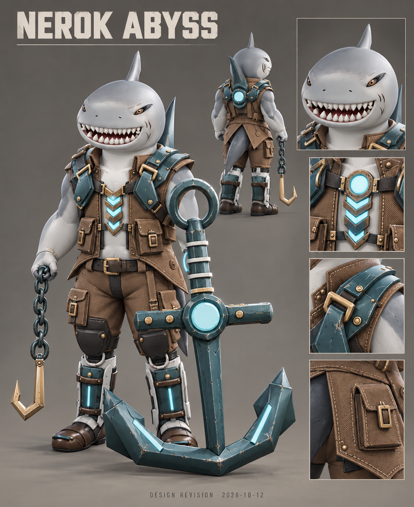

# Nerok Abyss — Herkunft und Entwurf

Interne ID: `Nerok`. Nachweissammlung erstellt am 2026-10-12.

## Zeitliche Einordnung

Die Chronik wird aus vorhandenen Repository-Commits rekonstruiert. Ein Commitdatum ist kein Beweis für den Zeitpunkt einer früheren Idee. Neue Konzeptblätter werden nicht rückdatiert.

| Commitdatum (UTC) | Entwicklungsschritt | GitHub-Beleg |
|---|---|---|
| 2026-10-03T18:47:23Z | Add Blender-authored cyber shark hero Nerok with anchor pull and maelstrom

Integrate complete hero catalog, multiplayer ability execution and replication, shop Epic anchor colorways, authored effects, five ability icons and selected ultimate MP3. Preserve concurrent account purchase and undersuit fabric updates.

Validated generated mesh payloads, source links, icon and audio assets; Unity build and play-mode validation remain to be run. | [f8494a68](https://github.com/Lowperformence/Alterverse/commit/f8494a6825ded72b05176eeb3aee7f5dd4171200) |
| 2026-10-03T19:20:01Z | Rework light-blue shark pirate, add chain pull VFX and 40 extra rechargeable shield

Blender-authored detailed shark and anchor. Add pooled interlocked chain tracking both endpoints and online target identity relay. Increase Nerok base rechargeable shield from 50 to 90. Preserve latest movement fixes.

Validated mesh data, vertex limits and all uploaded file hashes. Unity play-mode validation remains required. | [53b3e69e](https://github.com/Lowperformence/Alterverse/commit/53b3e69ed4137e0f8064d53684ffc2fb9cfe7d78) |
| 2026-10-03T19:26:45Z | Remove shark lantern, double anchor geometry and add healed skin scars

Regenerate Blender model and anchor projectile, preserve grip binding, reframe anchor icons, and add subtle bone-bound scars to exposed skin. Validated mesh channels, indices, vertex limits and uploaded file hashes. | [685d954b](https://github.com/Lowperformence/Alterverse/commit/685d954bdccde11fa2d51e1a0e8ab6bd1473f893) |
| 2026-10-03T19:49:38Z | Add five Blender shark attack illustrations, centred animated tail and dry anchor sounds

Rebind the anchor in the anatomy render frame instead of reusing the legacy gauntlet renderer. Add an editor skin/pose regression check. Tail starts centred and slowly sweeps +/-45 degrees over eight seconds. Preserve icon GUIDs and ability slots; the model generator rebuilds the pictorial icon set. Validated Blender build, model channels/indices, tail bounds, distinct icon images and unclipped audio. Unity runtime verification remains required. | [f9c736a4](https://github.com/Lowperformence/Alterverse/commit/f9c736a4a4d6cab2409c7431e22125a820119fdf) |
| 2026-10-03T22:17:58Z | Use selected Nerok hit and explosion audio; enlarge tail fin and share star-free meteor blast VFX | [dec80e61](https://github.com/Lowperformence/Alterverse/commit/dec80e61fb96f74b2687944d2a8165a76372df27) |
| 2026-10-04T15:06:40Z | Relax all hero idle arms and give Nerok natural grey skin with white belly | [d1455e78](https://github.com/Lowperformence/Alterverse/commit/d1455e78247c2bfe8169516ccea95e2245912609) |
| 2026-10-07T19:30:58Z | Enlarge Nerok cranial fin by 50 percent at its attachment | [034600a6](https://github.com/Lowperformence/Alterverse/commit/034600a61e82253a833685a23aebda9226f6a035) |
| 2026-10-07T19:39:26Z | Reshape Nerok mouth with rounded jaw and broad triangular shark teeth | [596cf643](https://github.com/Lowperformence/Alterverse/commit/596cf643fc906066ea9c8295ebb4a4b8f60670d3) |
| 2026-10-07T19:47:39Z | Unify Nerok skull snout jaw and mouth into one watertight head surface | [49ba3a5b](https://github.com/Lowperformence/Alterverse/commit/49ba3a5bb82f0812fb6bbd969b986f3061dbd346) |
| 2026-10-07T19:56:46Z | Refine Nerok shark face and close arm surfaces with blended elbow skinning | [3511f3b0](https://github.com/Lowperformence/Alterverse/commit/3511f3b07b1771aa756c431d2fefe636ec74a77b) |
| 2026-10-07T20:03:37Z | Halve Nerok head fin height while preserving its footprint | [c603b280](https://github.com/Lowperformence/Alterverse/commit/c603b2804f9c0958a2d451c60bb1da80e9d9cdf5) |
| 2026-10-07T20:06:49Z | Halve Nerok fin width across shoulders and restore its previous height | [fa1fd2f8](https://github.com/Lowperformence/Alterverse/commit/fa1fd2f8597fd0ed31c21fab0c374881021a812a) |
| 2026-10-07T20:11:33Z | Give Nerok a subtle grin by lifting the mouth corners | [916079a4](https://github.com/Lowperformence/Alterverse/commit/916079a48e6f0d282ca573ab734cf71bf7edd79d) |
| 2026-10-07T20:33:12Z | Add rust-brown free-hand chain hook with walking sway to Nerok | [563bd681](https://github.com/Lowperformence/Alterverse/commit/563bd681baf7f9d0cdd10c66616317267659655a) |
| 2026-10-07T20:42:00Z | Straighten Nerok's hanging chain and sharpen his grin | [dcad4c99](https://github.com/Lowperformence/Alterverse/commit/dcad4c9961d1025b1d9c8cd39c0a26b88c5d97a0) |
| 2026-10-08T18:28:26Z | Refine Nerok shark head toward the supplied reference

Broaden and shorten the muzzle, sculpt inset sloped eyes and brow folds, refine the raised-corner grin with primary/secondary teeth and gums, and add source-bound skin pigmentation and filtered denticle relief. Update the editable Blender source, runtime head mesh, three close-up renders and manual Unity presentation validation.

Preserve all 17,128 non-head triangles including their positions, normals, winding, skin weights and material slots. Retain the existing rig, accessory groups, hook grip, tail pivot and cranial-fin maximum height.

Validation: Blender 4.5.9 source/render review; closed manifold and consistent winding; finite unit normals, rigid head binding, mouth indices, exact body/weapon preservation and Python syntax checks. Unity/Android compilation and in-game performance were not executable in this environment. | [0dfcfa57](https://github.com/Lowperformence/Alterverse/commit/0dfcfa571533a84c898aba85d6f371c5daee2607) |
| 2026-10-11T21:50:21Z | Build authored hero heads, Tahla pauldrons and Nerok outfit | [8fa75d02](https://github.com/Lowperformence/Alterverse/commit/8fa75d02f0964e9df149ed3c073259fc50248d78) |

Die gemeinsame Builder-Chronik enthält auch Änderungen anderer Helden; nicht jede Zeile ist eine individuelle Änderung dieses Helden. Der jeweilige Diff ist der maßgebliche Beleg.

## Bestandteile und Quellen

Haikopf, Körper, Anker, Haken und Kleidung: Projektgenerator `Tools/CyberShark/build_cyber_shark.py`, Referenzkopf-Generator und PartsRedesign. Gemeinsamer Rook-Rig-/Template-Vertrag wird weiterverwendet; dies wird nicht als vollständig neu erfundenes Rig bezeichnet. Frühere Referenzbildrechte bleiben gesondert zu klären.

Animationen: Quaternius und KayKit gemäß Lizenzregister; Mixamo-Ruhepose separat, ausdrücklich nicht CC0. Die tatsächliche Nutzung ist in `ArtSource/Animations/README.md` beschrieben. Sounds sind separat pro Quelle/Slot zugeordnet und nicht pauschal mit der Modelllizenz abgedeckt.

## Neuer eigener Entwurf

Bild: `ArtSource/Heroes/Concepts/2026-10-12/Nerok-Abyss.png`. Datum: 2026-10-12. Vollständiger Prompt, Referenzrolle und Prüfsummen: `generation-records.json` im gleichen Ordner. Methode: eingebaute ChatGPT-Bildgenerierung. Die Referenz ist eine vorhandene Projekt-Modellvorschau; dieses Blatt ist eine neue Designrevision und kein ursprünglicher Vorabentwurf.

## Modellzuordnung und Grenzen

Runtime-Resource: `Assets/Alterverse/Resources/CyberShark/Model.bytes`.
Aktive mechanische/sichtbare Ersatzgeometrie: `Assets/Alterverse/Resources/CyberShark/Model.bytes`.
Neue Quellen und geometrische Abgleichprotokolle: `ArtSource/Heroes/ConceptRebuild/`. Nur ein vorhandenes Build-/Validierungsprotokoll belegt einen abgeschlossenen Export. Konzeptbilder sind keine Ingame-Screenshots. Unity-/Android-Prüfung wird nicht durch ein Blender-Render ersetzt.

Offen: historische Bildreferenzen und deren Nutzungsrechte; accountgebundene Downloadbelege soweit nicht verfügbar. Ein neuer Entwurf beseitigt diese historische Nachweislücke nicht.
