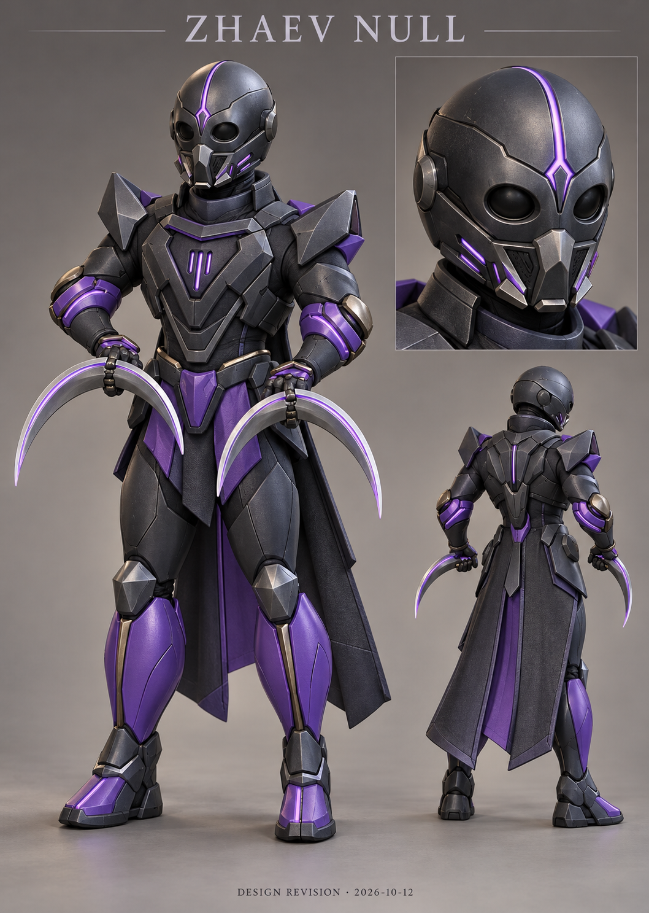

# Zhaev Null — Herkunft und Entwurf

Interne ID: `Veyr`. Nachweissammlung erstellt am 2026-10-12.

## Zeitliche Einordnung

Die Chronik wird aus vorhandenen Repository-Commits rekonstruiert. Ein Commitdatum ist kein Beweis für den Zeitpunkt einer früheren Idee. Neue Konzeptblätter werden nicht rückdatiert.

| Commitdatum (UTC) | Entwicklungsschritt | GitHub-Beleg |
|---|---|---|
| 2026-09-17T11:33:27Z | Add readable stylized hero silhouettes | [a4d6b7c0](https://github.com/Lowperformence/Alterverse/commit/a4d6b7c0a63c5130db15bafb78b8700e92af9c8e) |
| 2026-09-17T11:39:55Z | Fix combat namespace dependency in stylized hero visuals | [fcfbc894](https://github.com/Lowperformence/Alterverse/commit/fcfbc894947a1c6094c391fff9e43056d2171d4a) |
| 2026-09-17T12:29:59Z | Strengthen hero silhouettes and team readability | [10a86821](https://github.com/Lowperformence/Alterverse/commit/10a86821bf9cddc8055630fa349803db902af972) |
| 2026-09-17T12:33:12Z | Shape first-pass hero bodies and distinct silhouettes | [3f0dc25d](https://github.com/Lowperformence/Alterverse/commit/3f0dc25d614e817ffbfaf320832a819230fc2af9) |
| 2026-09-17T12:35:06Z | Add hero visual roots, legs and procedural motion support | [5cfc31ca](https://github.com/Lowperformence/Alterverse/commit/5cfc31caaaf72ca00e09aa957a20f1f3512cb2be) |
| 2026-09-17T12:36:23Z | Fix hero proportion expression compile safety | [1330d3ea](https://github.com/Lowperformence/Alterverse/commit/1330d3eaeacf87f8fea2f4041ec2ad8b5ef9037a) |
| 2026-09-17T12:39:00Z | Refine hero faces armor and signature equipment | [2e02561e](https://github.com/Lowperformence/Alterverse/commit/2e02561e08b31ae96b63289d6f03e0c1ef1a7183) |
| 2026-09-17T12:41:14Z | Enable hero-specific ambient presence effects | [3749a110](https://github.com/Lowperformence/Alterverse/commit/3749a110a7a111527a5edd83a4b0e33ef565aaf8) |
| 2026-09-17T12:52:39Z | Attach founder cosmetic lifecycle to player hero visuals | [07964337](https://github.com/Lowperformence/Alterverse/commit/0796433782bd29d633b42ad3250eefad79ee410c) |
| 2026-09-17T13:45:11Z | Strengthen hero silhouettes with dimensional signatures | [d29de261](https://github.com/Lowperformence/Alterverse/commit/d29de261ad5c4042589f40c8571177bdbc9cf5e3) |
| 2026-09-17T18:56:14Z | Remove balloon-like hero ground rings | [38178692](https://github.com/Lowperformence/Alterverse/commit/38178692c062307032692f2a89704f013e4ed404) |
| 2026-09-17T19:45:05Z | Remove hero placeholders and arm buff planets | [ffedf238](https://github.com/Lowperformence/Alterverse/commit/ffedf238afd0b3097a6747be611bb48cf3da01bc) |
| 2026-09-17T20:01:18Z | Fix respawn and recovery, clarify minion combat, add 8:30 objective and revise presentation | [e3a2d41a](https://github.com/Lowperformence/Alterverse/commit/e3a2d41a04cc89ed13548a30a992a70f1f76c4fc) |
| 2026-09-17T20:13:02Z | Rebuild arena presentation, tower silhouettes and beveled hero armor | [5f622c4e](https://github.com/Lowperformence/Alterverse/commit/5f622c4e92afb214344e084e9e14da303de7740e) |
| 2026-09-18T09:45:05Z | Rebuild six hero silhouettes with contour armor, distinct weapons and batched palette surfaces | [d0b51f66](https://github.com/Lowperformence/Alterverse/commit/d0b51f66f11694e9a6e261b0f4bdcecb62ff1a41) |
| 2026-09-18T15:31:42Z | Refine hero armor bevels and separate cloth, metal and energy surfaces | [8b340bc3](https://github.com/Lowperformence/Alterverse/commit/8b340bc35cf736b2ae3c0bf7ae5c0c48e433f8c6) |
| 2026-09-18T17:47:23Z | Drive hero locomotion by traveled distance and add movement regression checks | [68d9f341](https://github.com/Lowperformence/Alterverse/commit/68d9f34120df1aa53a16e706f135b4bdb9fafa7c) |
| 2026-09-18T20:36:07Z | Ship persistent VOIDFALL cosmetic flow and illustrated avatar shop | [3be7d3e0](https://github.com/Lowperformence/Alterverse/commit/3be7d3e05035428f78ba1391be98f3f80f5c6c9b) |
| 2026-09-18T21:05:47Z | Add cosmetic VOIDFALL dimensional wings and motion | [86f7e11c](https://github.com/Lowperformence/Alterverse/commit/86f7e11c00cb9c43c87b568bcc01e8e239f89669) |
| 2026-09-18T21:57:34Z | Bring lunar silhouettes and dimensional collision depth toward concept reference | [a3a16b60](https://github.com/Lowperformence/Alterverse/commit/a3a16b60f270d5bcbd6ede2f039d1ce503e53faf) |
| 2026-09-19T05:17:29Z | Refine six hero silhouettes, armor and weapons with batched detail | [25c1c275](https://github.com/Lowperformence/Alterverse/commit/25c1c275b5a5585bc58d02f6300c109013946590) |
| 2026-09-19T15:32:07Z | Apply 50 percent larger emissive weapon skins in game | [dc2f9794](https://github.com/Lowperformence/Alterverse/commit/dc2f97940afc2b3d8afeaf294888b667093b4bdf) |
| 2026-09-19T19:32:29Z | Overhaul six hero models and thirty combat presentations with pooled mesh VFX | [472a95b7](https://github.com/Lowperformence/Alterverse/commit/472a95b7442aa277adc39d7943b97934cf244c6d) |
| 2026-09-20T06:30:32Z | Attach lunar footprints to gameplay heroes | [cd7ffb76](https://github.com/Lowperformence/Alterverse/commit/cd7ffb7642931e488b2a9ccabed2a318165d4d8f) |
| 2026-09-20T07:46:25Z | Rebuild premium weapon skins with unique geometry | [412f0b6e](https://github.com/Lowperformence/Alterverse/commit/412f0b6eb6be93d2c1df1640ae5a25150854c386) |
| 2026-09-20T07:49:49Z | Revert premium weapon geometry overhaul | [7bfde479](https://github.com/Lowperformence/Alterverse/commit/7bfde479d226cd88ca9b0e3dc8fded3e436fe049) |
| 2026-09-20T08:03:50Z | Enlarge Rift Catalyst visuals by another 30 percent | [af00c14c](https://github.com/Lowperformence/Alterverse/commit/af00c14c483adcd0946102ceafbd2a12db352634) |
| 2026-09-20T08:06:42Z | Enlarge Rift Catalyst visuals by another 20 percent | [e2c72d78](https://github.com/Lowperformence/Alterverse/commit/e2c72d78a3ae4007bb01741f5613da0e4935a9d2) |
| 2026-09-20T08:13:23Z | Improve Breaker Fist finger readability | [7f2064c7](https://github.com/Lowperformence/Alterverse/commit/7f2064c76324d5858a1b16a72bf052273e2fe095) |
| 2026-09-20T08:19:24Z | Restore glowing Breaker Fist body and 50 percent scale | [029b3cdb](https://github.com/Lowperformence/Alterverse/commit/029b3cdb67b57e8fc3477a24ff9fbfd629405161) |
| 2026-09-20T08:22:07Z | Upgrade Anchor Hammer premium skin readability and scale | [f234064f](https://github.com/Lowperformence/Alterverse/commit/f234064f453ea9aab84490dcc7ca2a3a3ba5b108) |
| 2026-09-20T08:23:57Z | Make Anchor Hammer shaft glow | [d3cfbe77](https://github.com/Lowperformence/Alterverse/commit/d3cfbe7749384f14e43f78eee8b70d8844fc15fb) |
| 2026-09-20T08:26:55Z | Add glowing ruby to Anchor Hammer skin | [22707fa6](https://github.com/Lowperformence/Alterverse/commit/22707fa6429e5e965ddaf0cdbd2a11fed56f034a) |
| 2026-09-20T08:31:22Z | Polish Lifeweave staff size and red core | [bcee3e42](https://github.com/Lowperformence/Alterverse/commit/bcee3e42adb43540883d65819cc660490fc34e43) |
| 2026-09-20T08:32:40Z | Add glowing planet ring to Lifeweave staff | [1358c0f3](https://github.com/Lowperformence/Alterverse/commit/1358c0f3850e5c859a7f346f6f7a1fc3710920c4) |
| 2026-09-20T08:32:52Z | Fix Lifeweave planet ring glow source | [2cf95fd2](https://github.com/Lowperformence/Alterverse/commit/2cf95fd27874a8282994c23669680019ef67ac1c) |
| 2026-09-20T08:37:56Z | Polish Starline rifle premium skin | [45efda24](https://github.com/Lowperformence/Alterverse/commit/45efda24bdcb3b911c5ea22ac02e73c01d39dd44) |
| 2026-09-20T08:40:58Z | Polish Null Edge blades with red grips and details | [0f63a443](https://github.com/Lowperformence/Alterverse/commit/0f63a443fa3a1597cff84dd330f4bbfe24c4147f) |
| 2026-09-20T08:45:05Z | Make Null Edge premium details clearly visible | [f1c93226](https://github.com/Lowperformence/Alterverse/commit/f1c9322638ef94e1a7a474fac2132ed74b733cff) |
| 2026-09-20T08:48:59Z | Reverse Null Edge premium color concept | [1779e0a5](https://github.com/Lowperformence/Alterverse/commit/1779e0a52454488bdad90b5d8942b81f62f8ccf5) |
| 2026-09-20T08:53:28Z | Make Null Edge skin uniformly pink | [4486beef](https://github.com/Lowperformence/Alterverse/commit/4486beef5f055fc4761f565d6d0292dede663e26) |
| 2026-09-20T10:56:37Z | Render equipped Beta Supporter Wings on player heroes | [cd516375](https://github.com/Lowperformence/Alterverse/commit/cd516375bb7250dd5bcd8d4a477ae9e0678f89fb) |
| 2026-09-20T11:10:36Z | Render Plague Wings on equipped player heroes | [c3b88db8](https://github.com/Lowperformence/Alterverse/commit/c3b88db87271b24ec04dc12b58fe8f38d7808a64) |
| 2026-09-20T12:33:12Z | Rebuild cosmetic shop and inventory with scalable grids and per-hero equip migration | [d040525d](https://github.com/Lowperformence/Alterverse/commit/d040525d5fb2fc9b64442c4757a23590df761681) |
| 2026-09-20T14:18:34Z | Strengthen hero palette contrast and saturation | [e2f10ae8](https://github.com/Lowperformence/Alterverse/commit/e2f10ae8258b3cff4614b0fb55701f4b572d3dc9) |
| 2026-09-20T14:21:33Z | Revert hero color and contrast overhaul | [7047662d](https://github.com/Lowperformence/Alterverse/commit/7047662d7c597e309d89b2d1fd549ba2f4d1703d) |
| 2026-09-21T20:15:47Z | Upgrade Zhaev weapon skin to legendary Oblivion blades | [a8a423cf](https://github.com/Lowperformence/Alterverse/commit/a8a423cf95db222d235bf81f0c049257606b873e) |
| 2026-09-21T20:18:05Z | Support tiered Zhaev weapon skin visuals | [76cc1fcf](https://github.com/Lowperformence/Alterverse/commit/76cc1fcf8edcff9c678bdd819c6cad794da45cc3) |
| 2026-09-21T20:32:29Z | Match Kaelon premium hammer skin to breacher overhaul | [0081dc28](https://github.com/Lowperformence/Alterverse/commit/0081dc2838280aac19ac852d5ff5f55790ffd398) |
| 2026-09-21T20:33:11Z | Keep one Night Blossom weapon skin for Zhaev | [0cb95f04](https://github.com/Lowperformence/Alterverse/commit/0cb95f04ff513c6eed9412cba592fb55fcfee0be) |
| 2026-09-21T20:55:11Z | Create epic Reactor Breaker gauntlet skin for Brakk | [22273033](https://github.com/Lowperformence/Alterverse/commit/22273033a4d0e08e485f6e99bdb157bb39856126) |
| 2026-09-21T21:08:32Z | Create epic Red Judgement rifle skin for Nyra | [43fdefae](https://github.com/Lowperformence/Alterverse/commit/43fdefae8c2c209acc6a95736be989c0412cd802) |
| 2026-09-21T21:08:39Z | Replace mage orbit overdrive with Astral Orbit epic staff | [16ecd786](https://github.com/Lowperformence/Alterverse/commit/16ecd786b0b0eddc97169a7033db8bbff791e808) |
| 2026-09-21T21:37:01Z | Create Ascension of Aurora legendary healer staff | [f7d690c2](https://github.com/Lowperformence/Alterverse/commit/f7d690c2b3c67faca8e4170036b5feecd9dea809) |
| 2026-09-21T21:45:24Z | Add red reactor claw spikes to Brakk Orun epic weapon skin | [0d63ecc7](https://github.com/Lowperformence/Alterverse/commit/0d63ecc7dbc50e4a425d6ecf6a13191b53e4c33c) |
| 2026-09-21T21:51:10Z | Add smaller red claw racks to both Brakk epic gauntlets | [32c381e2](https://github.com/Lowperformence/Alterverse/commit/32c381e2d577b9d17278bf7d967bdec50060985e) |
| 2026-09-22T17:22:24Z | Apply legendary Chronolux treatment for Traveler | [6464850e](https://github.com/Lowperformence/Alterverse/commit/6464850e4e3981308a50f25b3859e64027269e37) |
| 2026-09-22T17:55:59Z | Use Planet Flux epic treatment for Traveler | [c7a288c9](https://github.com/Lowperformence/Alterverse/commit/c7a288c907cf4b573651ba8b9e8185771925bdcc) |
| 2026-09-22T19:26:58Z | Refine shared hero helmet and limb meshes | [63d9551e](https://github.com/Lowperformence/Alterverse/commit/63d9551e8a594201bc1570900b57edf439e60dbb) |
| 2026-09-25T16:33:50Z | Add polished Sivra scout, smooth hero surfaces and layered combat energy | [daa54dc8](https://github.com/Lowperformence/Alterverse/commit/daa54dc83a85a7f260e5eb1354be1d22c861992a) |
| 2026-09-25T17:29:25Z | Attach attack presentation to every combat hero | [a6b9c399](https://github.com/Lowperformence/Alterverse/commit/a6b9c399eafec44fa584bf09b5252fc746f6631a) |
| 2026-09-25T18:05:30Z | Make new hero weapon cores emissive in the shared material pipeline | [aebc1273](https://github.com/Lowperformence/Alterverse/commit/aebc1273fd658f06dff30c66a2bd21ce232e0db4) |
| 2026-09-25T19:01:58Z | Use distinct replacement geometry for paid hero weapons | [757caced](https://github.com/Lowperformence/Alterverse/commit/757cacedde19424c0ea69e350352947592ea0844) |
| 2026-09-25T19:45:13Z | Keep flowing cloak panels out of static hero batches | [df7c5f3a](https://github.com/Lowperformence/Alterverse/commit/df7c5f3a147bd57b97fbc0773549a3ef377332a5) |
| 2026-09-26T16:28:43Z | Apply equipped weapon variants to heroes | [ad66deb3](https://github.com/Lowperformence/Alterverse/commit/ad66deb3d530ba46ca329409dadd809783274342) |
| 2026-09-26T16:30:01Z | Render the selected signature weapon skin | [916b10cd](https://github.com/Lowperformence/Alterverse/commit/916b10cd0b39c4be870c0e7bf365070ae95b92f6) |
| 2026-09-26T16:50:30Z | Make default hero silhouettes and weapons readable in match view | [aeb6a2d6](https://github.com/Lowperformence/Alterverse/commit/aeb6a2d6ab9ac877f9115d784b72d5badea68974) |
| 2026-09-27T11:41:23Z | Animate the continuous back drapes | [5a235ac0](https://github.com/Lowperformence/Alterverse/commit/5a235ac06d4f8c6393f5ec35b8adf5fb319d6a5c) |
| 2026-09-28T05:33:09Z | Preserve articulated hero torso meshes during static batching | [63dcd686](https://github.com/Lowperformence/Alterverse/commit/63dcd6862d899219495b08a521a8b14b731eab0d) |
| 2026-09-28T07:10:26Z | Give Brakk standard and epic fists articulated finger contours | [b69691b6](https://github.com/Lowperformence/Alterverse/commit/b69691b63664ef33e8c4b1dd387402981b1ee9b6) |
| 2026-09-28T11:05:14Z | Preserve hero colors when equipping Voidfall wings | [771d96c1](https://github.com/Lowperformence/Alterverse/commit/771d96c159fa89134f094ebeafd3a5bb2627cfb7) |
| 2026-10-01T06:14:34Z | Modernize all seven heroes with inset armor details and coated surface highlights | [b9a9c30b](https://github.com/Lowperformence/Alterverse/commit/b9a9c30b9b837743119af6846b5a20f92632a1c4) |
| 2026-10-01T10:28:18Z | Modernize all seven heroes with curved armor, smooth anatomy, draped fabric and differentiated surfaces | [565e1d5d](https://github.com/Lowperformence/Alterverse/commit/565e1d5d8fd17f2a7f29360e0499f45d09847131) |
| 2026-10-01T15:18:22Z | Remove retired runtime scanners and weapon builders; fix material repair and hero colorways | [7bfe1190](https://github.com/Lowperformence/Alterverse/commit/7bfe1190bfa66059dd9dd0cf4572bfab3f8098a7) |
| 2026-10-01T16:59:25Z | Add seven Blender-authored hero rigs and coordinated attack VFX

Import weighted FBX models through a Generic Animator presentation while preserving actor movement, combat, visual-root cosmetics and existing ability signals. Include editable Blender sources, nine animation clips per hero, rendered previews and a reproducible generation/round-trip validation pipeline.

Add feathered blade arc ribbons, narrow projectile streaks and green healing leaves to the shared budgeted VFX pool. Preserve the purple traveling Rift Scar X and authoritative hit timing.

Validation: seven FBX round trips, weighted vertices/bones/clips and C# syntax checks. Unity compilation, imported-controller rendering and Android runtime validation remain pending. | [7847a8eb](https://github.com/Lowperformence/Alterverse/commit/7847a8eb42d945f909b88c3b0a606e68863cdd23) |
| 2026-10-01T17:40:32Z | Restore original hero movement on authored rigs and update weapon shop

Retarget existing procedural gait, combat and body motion to new hero skeletons. Separate skinned weapons for existing shop colorways. Individualize all seven heroes with broader tanks, masks, helmets, crescent blades and shaped boots; include Blender sources and previews.

Validated seven FBX roundtrips and C# syntax. Unity runtime validation remains pending. | [37621e1e](https://github.com/Lowperformence/Alterverse/commit/37621e1e0155294cf926d3ec9c92b270fbc8a7bc) |
| 2026-10-01T18:11:56Z | Correct imported hero guards and gait; individualize five hero designs

Fit Veyr, Traveler and Nyra guards to real arm chains; correct imported thigh direction while keeping the 35 percent slower gait. Reduce Sivra move speed by 10 percent, add a cyborg face and precision rifle, and slim Sivra/Veyr boots.

Redesign Traveler as a dark hooded armored chronomancer, Tahla as a white-gold priestess, and Ione with a sealed demon helm and great glowing horns from supplied references. Preserve green healing, violet attack VFX and separate shop weapons. Include updated Blender sources and previews.

Seven FBX roundtrips, Blender guard simulations, C# syntax and uploaded blob hashes checked. Unity runtime/device validation remains pending. | [0b81c3b2](https://github.com/Lowperformence/Alterverse/commit/0b81c3b2a0d67dd49d0cac3cc32e78e7697692d2) |
| 2026-10-01T18:31:40Z | Fix bent forearms for all seven heroes with independent weapon grips

Separate WeaponGripL/R child bones from anatomical hands. Retarget wrist controls only to hands, keep guard wrists neutral relative to forearms, and apply weapon angles only to grip bones. Update all FBX/Blender rigs and source clips; preserve shop weapon renderers and hand-anchored muzzle sockets.

Seven FBX roundtrips validate neutral idle wrists, coincident hand/grip anchors, independent weapon weights, normalized body skin and 19-bone rigs. Blender guard portraits, C# syntax and all 29 uploaded blob hashes checked. Unity runtime validation remains pending. | [52de95b7](https://github.com/Lowperformence/Alterverse/commit/52de95b774606b4bbb416fea786429f27e36a4de) |
| 2026-10-01T18:59:08Z | Redesign Ione as a blonde elf mage and fit all hero weapon grips

Replace the sealed demon helm with an open female elf face, layered blonde hair, pointed ears, silver diadem and fitted violet-gold robes. Fit weapon handle centers to palm anchors, model curled gripping fingers and neutral wrists, and remove independent world-space weapon rotation. Add class-specific guards for all seven imported heroes and reachable live rifle support for Sivra. Position Brakk's armor gauntlets around his fists.

Preserve legacy gait/body/action delivery and isolated weapon-shop renderers. Update seven FBX/Blender models, generator, guard simulation, previews and validation. Seven FBX round trips verify normalized weights, 19 bones, nine clips and rigid sampled handle/palm contact. Seven Blender guard simulations and C# syntax pass; Unity runtime/Android verification remains pending. | [519eaaf6](https://github.com/Lowperformence/Alterverse/commit/519eaaf69a0f5650ecac402180fd94568a3159d9) |
| 2026-10-01T19:36:49Z | Refine all hero arm proportions, redesign Ione and add authored planet surface details | [8c0543ee](https://github.com/Lowperformence/Alterverse/commit/8c0543ee491af4d8106fd3a373eee172b693fe79) |
| 2026-10-01T19:50:28Z | Sculpt distinct male and female arm and leg volume across all seven heroes | [4d00aab1](https://github.com/Lowperformence/Alterverse/commit/4d00aab17857b3558460c8a3ca1099c050b6f1b5) |
| 2026-10-01T20:09:31Z | Add universal Blender-authored connected map border and redesign Tahla Venn | [1396f240](https://github.com/Lowperformence/Alterverse/commit/1396f240a0873936f2bb200a35d6a627fd4a0e87) |
| 2026-10-01T20:18:40Z | Give Zhaev Null a closed gunmetal scout helmet with eye apertures and antenna | [2efc4831](https://github.com/Lowperformence/Alterverse/commit/2efc483115f8d1032a895758b28abc80376b2a22) |
| 2026-10-01T20:45:15Z | Improve fractured arena edges and hero arm, shoulder and boot shapes | [9e4443f4](https://github.com/Lowperformence/Alterverse/commit/9e4443f49967371f425acf73aedbc3b09a12e7a3) |
| 2026-10-02T05:07:42Z | Refine hero silhouettes and add Blender-authored planet geology and bunker details | [f4009fef](https://github.com/Lowperformence/Alterverse/commit/f4009fefab0d407ed1540682628caedf1f920538) |
| 2026-10-02T15:11:29Z | Add hero death HA, balance updates, armor, avatars and map purchases | [9b36bfa4](https://github.com/Lowperformence/Alterverse/commit/9b36bfa460c4c7d20fcb2ded9007da15eae3bdb2) |
| 2026-10-02T15:30:51Z | Double hero hands, shrink wings and add purchasable Deluxe crystal wings with 50% match bonuses | [5d006bd4](https://github.com/Lowperformence/Alterverse/commit/5d006bd44e14f6702cabb59ea8a0b5d0f4fe8720) |
| 2026-10-02T17:58:10Z | Remove Brakk scalp hair while retaining beard, brows and armor details | [241f7b29](https://github.com/Lowperformence/Alterverse/commit/241f7b29ac5dbbf0827f285e84f6c02480b37a7a) |
| 2026-10-02T18:18:09Z | Fix Zhaev helmet light fitting and remove scout antenna | [e14ff277](https://github.com/Lowperformence/Alterverse/commit/e14ff2773236cd13a80c5be34e2081e00b48ebbf) |
| 2026-10-03T18:26:50Z | Lighten hero undersuits and add second Traveler leg phone

Use a clearly visible anthracite for the fabric undersuit material, including its procedural runtime material copy and source builder. Fit matching phone devices to the outer sides of both Traveler thighs.

Validation: static checks confirm the anthracite assignment and phone generation on both sides. Unity visual validation remains unavailable here. | [0759239d](https://github.com/Lowperformence/Alterverse/commit/0759239d05b61986ce225627a59ad416803e9355) |
| 2026-10-09T10:45:38Z | Fix match recovery, recall interruption and local online presentation

Return failed arena/hero/roster builds through existing session cleanup instead of leaving the menu hidden. Report direct online build failure. Check final-frame recall movement and block paused/disabled manual respawn; guard zero-delay bot respawn.

Resolve guest/host presentation through the local roster slot rather than server-owned respawn. Keep own cosmetics, weapon colors, founder markers, planet HUD and result audio on the local hero. Preserve all audio/model/map assets, balance and prior locomotion.

Retire stale seven-hero and invalid operation-ID test assumptions, remove an orphan folder meta/no-op audio callback and add ten missing script metas. Add a detailed flow checklist, source/asset inventory and portable production lifecycle regressions.

Validation: 2,760 isolated lifecycle assertions; eight original-code negative-control failures; 98 commerce/social server tests; 9,274 existing VFX assertions; 261,846 existing upper-body assertions; seven embedded map meshes; 463 C# syntax parses; all 865 existing meta GUIDs; 66 constant resource loads. Engine/network/render factories and external services are test doubles. Real Unity 6000.6.1f1 builds, all maps/heroes on Android, live multiplayer/checkout and eight existing FBX importers remain explicitly unverified in the checklist. | [7b2cbc18](https://github.com/Lowperformence/Alterverse/commit/7b2cbc18387b69fcabcc729d7b737bf87a6ef036) |
| 2026-10-11T10:10:11Z | art: replace every hero's feet with reference-shaped ankle boots

Add rounded toes, ankle shafts, padded open collars, pull tabs, and welted soles with heels and arch recesses. Fit both boots to each existing rig and sole height, blend the shafts onto shin bones, and use hero-specific palette accents. Cover all eight heroes and procedural fallback models.

Remove instance footwear triangles while preserving shared assets. Grounding now samples visible indexed geometry so discarded source feet cannot affect contact height.

Validation: production component compiled and exercised against engine fixtures for geometry, skinning, all eight heroes, paired-foot replacement, and idempotence. Three-angle geometry inspection, outward floor winding, and edited C# syntax checks passed. Native Unity/device visual verification remains pending. | [aa992833](https://github.com/Lowperformence/Alterverse/commit/aa992833aad7ce5c843f0f4dcb757c80a7a868ce) |
| 2026-10-11T10:42:12Z | Remove all Brakk upper-arm, forearm and shoulder attachments

Remove silver plates, grey fabric cages and all other added arm surfaces instead of lifting surviving plates. Preserve connected arm anatomy, UVs, textures, existing colors and the shared Nerok source model. Remove rigid arm accessories and stop procedural/source builders from recreating them.

Validation: production cleanup compiled with Mono/Roslyn and passed 1549 fixture assertions, including merged meshes, material/source preservation, UV seams, blended attachment weights, repeated application and Nerok/hand isolation. The previous cleanup fails the silver-plate control. C# syntax and Python generator/filter checks pass. Rendered Unity verification remains pending. | [9ddf6e01](https://github.com/Lowperformence/Alterverse/commit/9ddf6e01ece1c9c96355c0195619030d0a5ad861) |
| 2026-10-11T11:04:37Z | Give Brakk's rear spinal reactor fluorescent red emission

Split rear chest-bound reactor triangles from the shared Energy slot on Brakk instances. Use the included runtime lit shader with bright red HDR emission; preserve the eye, chest relic, shared Nerok source, geometry and existing arm cleanup. Track the new mesh/material through the current owner and give the Blender builder a dedicated reactor material for future regeneration.

Validation: 146 production mesh/material fixture checks pass on Mono/Roslyn, including front/rear separation, four bone-weight slots, transformed coordinates, absent slots and source preservation. Changed C# parses and Python builder compiles. Native Unity/Android rendering remains unverified; global bloom and gameplay values are unchanged. | [0079df52](https://github.com/Lowperformence/Alterverse/commit/0079df522932750d982b03185340dcfaf230ed55) |

Die gemeinsame Builder-Chronik enthält auch Änderungen anderer Helden; nicht jede Zeile ist eine individuelle Änderung dieses Helden. Der jeweilige Diff ist der maßgebliche Beleg.

## Bestandteile und Quellen

Historische anatomische Basis: Blender Human Base Meshes 1.4.1, CC0 laut Originalprojekt-README. Kleidung, Waffen, Rig und Bearbeitungsschritte: Projektbuilder und Commit-Diffs. Bei mechanischen Ersatzkörpern wird die sichtbare Geometrie separat durch den jeweiligen Generator erzeugt; das importierte Rig-/Anatomie-Template bleibt Teil der Abhängigkeit.

Animationen: Quaternius und KayKit gemäß Lizenzregister; Mixamo-Ruhepose separat, ausdrücklich nicht CC0. Die tatsächliche Nutzung ist in `ArtSource/Animations/README.md` beschrieben. Sounds sind separat pro Quelle/Slot zugeordnet und nicht pauschal mit der Modelllizenz abgedeckt.

## Neuer eigener Entwurf

Bild: `ArtSource/Heroes/Concepts/2026-10-12/Zhaev-Null.png`. Datum: 2026-10-12. Vollständiger Prompt, Referenzrolle und Prüfsummen: `generation-records.json` im gleichen Ordner. Methode: eingebaute ChatGPT-Bildgenerierung. Die Referenz ist eine vorhandene Projekt-Modellvorschau; dieses Blatt ist eine neue Designrevision und kein ursprünglicher Vorabentwurf.

## Modellzuordnung und Grenzen

Basis-Unity-Resource: `Assets/Alterverse/Resources/AuthoredHeroes/Veyr.fbx`.
Neue Quellen und geometrische Abgleichprotokolle: `ArtSource/Heroes/ConceptRebuild/`. Nur ein vorhandenes Build-/Validierungsprotokoll belegt einen abgeschlossenen Export. Konzeptbilder sind keine Ingame-Screenshots. Unity-/Android-Prüfung wird nicht durch ein Blender-Render ersetzt.

Offen: historische Bildreferenzen und deren Nutzungsrechte; accountgebundene Downloadbelege soweit nicht verfügbar. Ein neuer Entwurf beseitigt diese historische Nachweislücke nicht.
